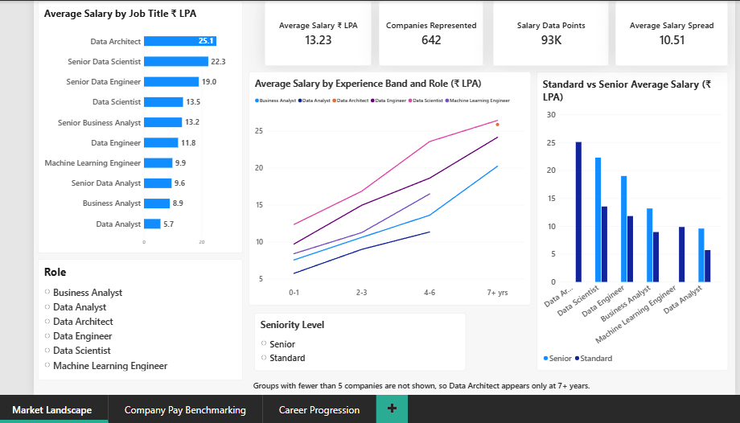
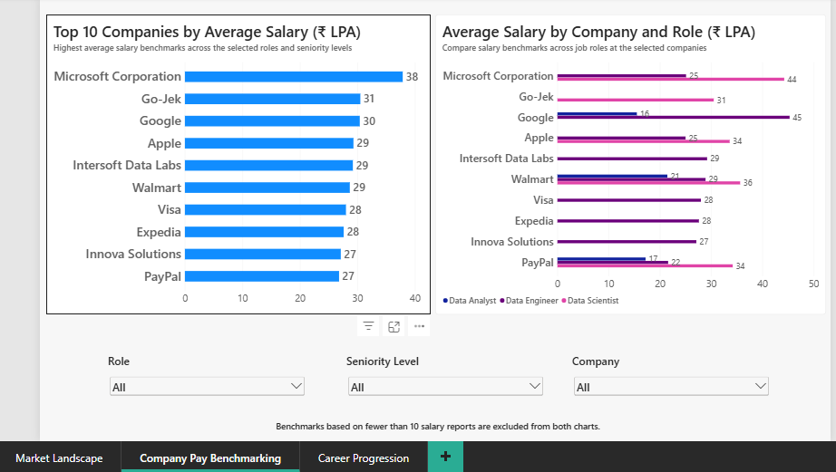
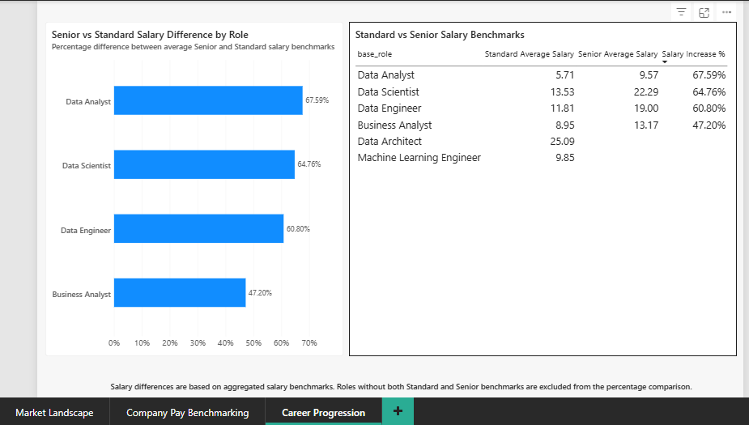

# India Data & Analytics Salary Benchmarking

SQL Server + Power BI project analysing salary benchmarks for data and analytics roles in India: which roles pay what, how pay grows with experience, how much a "Senior" title adds, and which companies pay the most.

## Dashboard

Power BI file: `salary_benchmarking_dashboard.pbix` (open with Power BI Desktop). It was built on a local SQL Server database; to refresh it, rebuild the database with the SQL scripts below.

**Market Landscape**

**Company Pay Benchmarking**

**Career Progression**

## Dataset

- **Source:** [Data Science Jobs In India](https://www.kaggle.com/datasets/madhurpant/data-science-jobs-in-india) (Kaggle, by madhurpant), scraped from AmbitionBox. License: CC0 Public Domain.
- **Size:** 1,602 company-role benchmarks across 642 companies and 10 job titles, built from about 93,000 individual salary reports.
- **Fields:** company, job title, minimum experience, average / minimum / maximum salary (₹ lakhs per annum) and the number of salary reports behind each benchmark.

### Limitations

- Salaries are self-reported by users of a website, so they carry reporting bias.
- The data has no dates, so it shows a snapshot, not a trend.
- There is no skills, city or industry column, so the analysis covers pay and experience only.
- "Senior" is taken from the job title text, not from actual years of experience.
- Experience bands use each benchmark's minimum experience.

## Data model

Star schema with one fact table:

| Table | Role | Rows |
|---|---|---|
| `salary_benchmarks` | Fact: one row per company and job title, with salary figures and the number of reports behind it | 1,602 |
| `companies` | Dimension | 642 |
| `job_titles` | Dimension: splits titles like "Senior Data Analyst" into `base_role` and `seniority_level` | 10 |

## SQL

| File | What it does |
|---|---|
| `sql/01_create_tables.sql` | Creates the three tables with primary and foreign keys |
| `sql/02_load_and_transform.sql` | Builds the dimensions and fact table from the raw staging table, using `ROW_NUMBER()` for keys and `CASE` / `REPLACE` to split seniority from the role name, then runs sanity checks |
| `sql/03_analysis_queries.sql` | Eight analysis questions using joins, CTEs, window functions (`DENSE_RANK`), `HAVING` and `CASE` bands |

Raw salary values arrive as text such as `7.8L` and are converted to numbers during import into the staging table.

## Key findings

- **Business Analyst roles out-earn Data Analyst roles at every comparable experience band.** At 4-6 years of minimum experience the average is 13.6 LPA for Business Analysts against 11.3 LPA for Data Analysts. At the Senior level it is 13.2 against 9.6 LPA.
- **A Senior title adds roughly 47% to 68% over the standard title**, depending on the role: Data Analyst 67.6%, Data Scientist 64.8%, Data Engineer 60.8%, Business Analyst 47.2%. Data Analyst has the biggest jump partly because it starts from the lowest base (5.7 LPA).
- **Pay rises with experience in every role**, and the 7+ year band is the highest for most roles.

## Data quality notes

- **Small samples can mislead.** The Data Analyst 7+ years point is built from only 2 company benchmarks, against 50 or more for the other Data Analyst bands, so it shows an apparent drop that is not a reliable finding. The experience-band query excludes any role and band with fewer than 5 distinct companies (`HAVING COUNT(DISTINCT company_id) >= 5`). That removes 3 of the 22 role-and-band groups: Data Analyst at 7+ years (2 companies) and Data Architect at 2-3 years (1 company) and 4-6 years (4 companies).
- **The headline average depends on how it is weighted.** The dashboard's average salary of 13.23 LPA is the simple average of the 1,602 benchmarks. Weighted by the number of salary reports, it is about 9.7 LPA, because large employers with many reports tend to pay less than small employers with a few.
- **Top-paying companies need a minimum sample.** About a quarter of the benchmarks (401 of 1,602) rest on fewer than 10 salary reports, and some of the highest averages come from as few as 5, so one or two high salaries can swing the number. The company ranking query and the dashboard's Top 10 chart keep only benchmarks built from at least 10 reports.

## Tools

SQL Server (T-SQL), Power BI (data modelling, DAX measures, 3-page dashboard)
